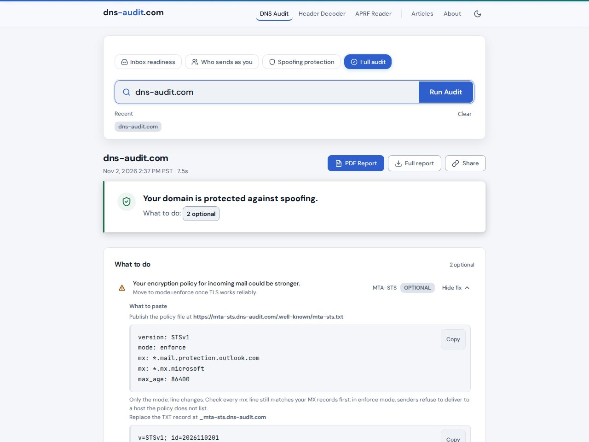

# dns-audit.com

[](https://github.com/marmot7775/dns-audit/actions/workflows/tests.yml)
[](https://github.com/marmot7775/dns-audit/actions/workflows/lint.yml)

**DNS and email security audit, with DMARC checked against RFC 9989**

dns-audit.com audits a domain's DNS and email security: enter a domain and get plain-language findings and copy-paste DNS records that fix them. DMARC is checked against RFC 9989, the current standard, and against the RFC 7489 behavior most receivers still implement; [the RFC 9989 article](https://dns-audit.com/articles/dmarcbis) explains what changed. Live at [dns-audit.com](https://dns-audit.com).

## A real result

dns-audit.com audited on 2 November 2026 (Full audit), in 7.5 seconds. The headline reads "Your domain is protected against spoofing." with "What to do: 2 optional" under it. The Technical summary shows Spoofing protection: Full and Protocol coverage: 7 of 9. Four of its twelve cards, each with the record it judged:

| Check | Status | Evidence |
|-------|--------|----------|
| DMARC | Pass | `v=DMARC1; p=reject; rua=mailto:hgx4xes7dg@rua.powerdmarc.com,mailto:dmarc_agg@vali.email; ruf=mailto:hgx4xes7dg@ruf.powerdmarc.com;` p=reject, and both report destinations are authorized. |
| SPF | Pass | `v=spf1 include:spf.protection.outlook.com ~all` 1 DNS lookup of the 10 allowed. |
| MTA-STS | Could be stronger | `v=STSv1; id=20261025T0001;` with a policy in testing mode: senders attempt TLS but will not refuse delivery if it fails. The plan row gives the policy file with `mode: enforce` and the new `id=` to publish with it. |
| Certificate Transparency | 14+ certs | 14 or more active certificates from 3 issuers. Cert Spotter returned the first 14 of a longer list, so the card says expiry was not judged rather than guessing. |

The last row is the rule the tool is built on: what a lookup did not read is not judged, and a lookup that did not complete is reported as Not checked, never as a pass or a fail. [ARCHITECTURE.md](ARCHITECTURE.md) lists the others.



## Running an audit

Enter a domain at [dns-audit.com](https://dns-audit.com) and pick the question you are asking. Each pill runs only the checks it needs:

| Pill | Scope key | Checks |
|------|-----------|--------|
| Inbox readiness (the default) | `deliverability` | DMARC, SPF, DKIM, MX |
| Who sends as you | `senders` | DMARC, SPF, DKIM, MX, plus the Sender Map |
| Spoofing protection | `email_security` | DMARC, SPF, DKIM, MX, MTA-STS, TLS-RPT, DANE, BIMI |
| Full audit | `complete` | All twelve |

The pills also sit on the results page, so you can switch question without retyping the domain. Inbox readiness and Who sends as you grade a `p=none` DMARC record as a pass, because Gmail, Yahoo and Microsoft accept it from bulk senders; the other scopes grade it as could be stronger.

Or call `GET /api/audit?domain=example.com` for the same result as JSON. Optional parameters: `selector` names your DKIM selector, and `scope` takes one of the keys above or `dmarc` or `dns_security` (DNSSEC, CAA, DANE, nameservers, CT), which have no pill. With no scope the API runs `complete`. The older scope keys (`email_full`, `transport`, `dns_infra`, `security_scan`) still work and map to the new ones. The [PDF report](#api) carries the same result.

dns-audit.com reads public DNS for the domain you name, and nothing else: no pasted headers, no uploads, no test messages.

## What it does not do

- No blocklist lookups.
- No mail sending and no SMTP connections. Outbound traffic is DNS plus HTTPS fetches of MTA-STS policies, BIMI logos, and certificate logs (crt.sh, with Cert Spotter as the fallback), and error reports to Sentry when SENTRY_DSN is set.
- No accounts.
- No stored audit history beyond the 90-day DNS snapshot table. Results are cached in memory for five minutes. Usage is logged: the request log keeps each audit's domain, scope, duration and coarse browser labels, plus a short usage note from each of the two sister tools. Every field is listed on [the privacy page](https://dns-audit.com/privacy).

## 12 Security Checks

### Authentication

| Check | What It Does |
|-------|-------------|
| **DMARC + RFC 9989** | Validation against RFC 9989 and against RFC 7489, side by side, with a per-tag decoder, dangerous-combination detection, an RFC 9989 readiness panel, and the DNS tree walk of [RFC 9989 Section 4.10](https://www.rfc-editor.org/rfc/rfc9989.html#section-4.10) for hierarchical policy discovery. |
| **SPF** | Syntax validation, mechanism analysis, recursive evaluation with full lookup chain tracing, void lookup detection (MX hosts with no address count too), and vendor-labeled include tree visualization. The walk stops after 100 DNS queries; past that the lookup count is reported as a floor ("at least N"). Flags `+all`, `?all`, missing `all`, `redirect`+`all` conflicts, deprecated `ptr`, an include or `mx` that is a PermError, overly broad CIDRs, and invalid IPs. |
| **DKIM** | Selector discovery from [Sendermap](https://github.com/marmot7775/sendermap)'s catalog: its selector sweep (about 110 names) plus a short local list of names seen in production, with the vendors the domain's SPF and MX point at tried first. A sweep of 156 common generic names runs only when those find nothing. Key strength analysis for RSA (1024/2048/4096) and Ed25519. Direct lookup of user-supplied selectors. Wildcard DNS detection prevents false positives. |

### Mail and Transport

| Check | What It Does |
|-------|-------------|
| **MX Records** | Mail exchanger discovery, vendor fingerprinting, redundancy analysis, dangling MX detection, null MX (RFC 7505) recognition. Major providers recognized as internally redundant. |
| **MTA-STS** | `TXT` record validation, HTTPS policy file retrieval and parsing, mode analysis (`enforce`/`testing`/`none`), MX pattern cross-referencing, `max_age` evaluation. |
| **TLS-RPT** | SMTP TLS reporting record validation, including the syntax of each report destination (`mailto` and `https`). |
| **BIMI** | Record parsing, DMARC enforcement prerequisite check (including inherited policies), SVG logo fetch with Tiny PS profile validation, script element detection, external reference scanning, `viewBox` verification, file size check, VMC certificate tag analysis. |

### DNS and Cryptographic Controls

| Check | What It Does |
|-------|-------------|
| **DNSSEC** | `DNSKEY` presence, `DS` record validation at parent zone (recursive + direct parent NS query), algorithm analysis against the IANA DNSSEC algorithm registries, which RFC 9904 made the canonical source in place of RFC 8624, chain of trust verification via `AD` flag and `DS`-to-`DNSKEY` digest matching. |
| **CAA** | Certificate Authority Authorization records, issuer restrictions (`issue`), wildcard policy (`issuewild`), incident reporting (`iodef`). |
| **DANE** | `TLSA` record lookup for each MX host, usage/selector/matching type analysis, DNSSEC dependency enforcement per RFC 7672. |

### Infrastructure and Certificates

| Check | What It Does |
|-------|-------------|
| **Nameservers** | NS count, resolution and authoritative response verification, `SOA` serial consistency, IPv6 support, network diversity across /24 ranges, provider identification. |
| **Certificate Transparency** | CT log query via crt.sh, falling back to Cert Spotter when crt.sh does not answer; issuer breakdown, CAA mismatch detection, expiring certificate alerts that skip certificates already renewed, subdomain discovery. When both logs are silent the card is Not checked, retries once by itself, then offers Try again. |

### Draft standards

APRF (inbox placement reports, an IETF working group draft) is checked for information only and never changes a result. A published record gets its own card under Draft standards; no record is one collapsed line.

## How Results Are Presented

There are no letter grades and no numeric score. The fixes come first:

1. **Headline.** One sentence that answers the question you picked, with the What to do counts under it (to fix now, important, recommended, optional). Each count jumps to its first row.
2. **What to do.** One prioritized fix list across all protocols, in four tiers. The first row opens with its fix showing. Each fix says who makes the change and gives the exact record to paste.
3. **Records to change.** Every record the plan asks for, in order, in one table. When the nameservers name a known DNS host (16 are mapped, Cloudflare and Route 53 among them), its steps for adding a record sit above the table.
4. **Sender requirements.** A closed checklist of the Gmail, Yahoo and Microsoft sender rules: SPF, DKIM and DMARC graded from the cards, and the five requirements DNS cannot show listed as such. Shown on Inbox readiness and Full audit.
5. **What changed.** Audit the same domain and scope again and the page lists what was fixed and what is new since the previous run.
6. **The checks.** Behind one closed Show all checks toggle, grouped into sending, receiving and the domain's DNS. A closed Technical summary holds two metrics: Spoofing protection (whether direct, subdomain and non-existent-subdomain spoofing are closed by the DMARC policy) and Protocol coverage (how many of nine protocols are configured).

Each card shows what it read, a status pill and a copy-paste fix where one applies. The pills are Pass, Could be stronger, Needs fixing, Optional, not set up (an optional protocol that is not published, never counted as a warning), and Not checked (the lookup did not complete). A few cards use more specific words, such as Does not apply or No mail, by design.

DNS cannot list DKIM selectors, so name yours for the best result; an undetected selector is never marked down.

## Features

- **RFC 9989 tree walk**: Section 4.10 policy discovery, capped at eight queries, beside the RFC 7489 lookup, with a strict record validator (38 finding codes).
- **SPF trace**: every `include` and `redirect` with its lookup cost, vendors labeled.
- **Defensive DNS**: null MX, `v=spf1 -all` and `p=reject` read as a non-mail domain, not as missing records.
- **Resilience**: whether mail still passes DMARC when SPF or DKIM fails alone.
- **Anomalies**: cross-check findings, such as MTA-STS without TLS-RPT.
- **Sender Map**: Who sends as you draws every service [Sendermap](https://github.com/marmot7775/sendermap) finds in DNS (MX, the SPF tree, DKIM keys, bounce and tracking CNAMEs, verification tokens, report addresses), on the domain and its sending subdomains. Each service shows how sure the map is (in use, configured, likely, account only), the record that names it and the records its setup still needs. A service with a risk on its own record is amber; risks no service explains are listed in red under Across the domain. A map that does not finish inside its 8 second budget is Not checked, with no services claimed.
- **PDF report**: PDF Report is the report a client reads: verdict and counts, every fix written out, the records to change, sender requirements, then the checks. Full report adds Part 2, the technical appendix.
- **Shareable links**: the address bar carries the domain, scope and DKIM selector of the result on screen.

## Architecture

Single-page app on FastAPI, dnspython and reportlab, with vanilla JavaScript. No accounts, no cookies and no third-party analytics. The only database is a SQLite table of DNS records seen in past audits, used for change detection and pruned after 90 days. Every merge to main deploys to dns-audit.com.

The site header links two sister tools on their own subdomains, the Email Header Decoder and the APRF Report Reader. They are separate apps; dns-audit.com itself only reads DNS.

The pipeline from request to report, which module owns what, and the rules the code keeps: [ARCHITECTURE.md](ARCHITECTURE.md). Why it is built this way: [docs/decisions](docs/decisions/). Review history: [docs/history](docs/history/README.md). Changes: [CHANGELOG.md](CHANGELOG.md).

## API

```
GET  /api/audit?domain=example.com              JSON response
GET  /api/audit/stream?domain=example.com       SSE streaming
GET  /api/audit/{domain}/pdf                    PDF download (appendix=0 leaves out Part 2)
GET  /api/ct?domain=example.com                 The Certificate Transparency card alone, asked again
POST /api/usage                                 Usage notes from the two sister tools
GET  /api/health                                Health check (DNS resolution, negative lookups, threads, running commit)
```

Optional parameters on the audit and PDF endpoints: `selector`, `scope`. The audit, stream, PDF and CT endpoints share one rate limit of 10 requests per IP per minute. Results cached for 5 minutes.

## Self-Hosting

The Python floor (3.12, because Sendermap requires it) and the dependencies are declared once, in [pyproject.toml](pyproject.toml). The requirements files are generated from it.

```bash
pip install -r requirements.txt
uvicorn server:app --host 127.0.0.1 --port 8000
```

Run it behind a reverse proxy that terminates TLS, bound to loopback. Exposed on 0.0.0.0, set `TRUSTED_PROXY_IPS=` (empty), or any client can rotate `X-Real-IP` past the rate limit. Keep uvicorn's proxy headers trusting loopback only (`--forwarded-allow-ips 127.0.0.1`, the default). Run one worker: the cache, rate limiter and concurrency budget are per process. `/api/health` reports the running commit SHA; `BUILD_SHA` overrides it.

### Configuration

All optional, read from the environment ([config.py](config.py)):

| Variable | Default | What it sets |
|----------|---------|--------------|
| `AUDIT_NAMESERVERS` | the system's upstreams plus 1.1.1.1 and 8.8.8.8 | The nameservers the audit queries, comma separated |
| `TRUSTED_PROXY_IPS` | `127.0.0.1,::1` | Peers whose `X-Real-IP` header is trusted |
| `RATE_LIMIT_MAX`, `RATE_LIMIT_WINDOW` | `10`, `60` | Requests per IP per window, in seconds |
| `MAX_CONCURRENT_AUDITS` | `8` | Audits running at once |
| `CACHE_TTL`, `CACHE_MAX_SIZE` | `300`, `500` | Result cache lifetime in seconds, and entries |
| `CORS_ORIGINS` | `https://dns-audit.com,https://www.dns-audit.com` | Allowed origins, comma separated |
| `LOG_DIR`, `LOG_LEVEL` | `./logs`, `INFO` | Where the error and audit logs go, and the log level |
| `SENTRY_DSN` | unset | Error reports to Sentry; unset sends none |
| `BUILD_SHA` | read from git | The version `/api/health` reports |

## Tests

```bash
pip install -r requirements.txt -r requirements-dev.txt
python3 -m pytest tests/ -q
```

More than 3,000 tests, run against fake DNS zones. The `no_network` fixture fails any TCP connection off the machine; UDP DNS still gets past it. Browser tests need Playwright (requirements-dev.txt) and `python -m playwright install chromium`, and skip without them.

To change something: [CONTRIBUTING.md](CONTRIBUTING.md).

## License

MIT. See [LICENSE](LICENSE).

## Author

**[Neil Anuskiewicz](https://www.linkedin.com/in/neilanuskiewicz/)**
DNS, email security, and deliverability specialist.

[LinkedIn](https://www.linkedin.com/in/neilanuskiewicz/) | [GitHub](https://github.com/marmot7775) | [dns-audit.com](https://dns-audit.com)
